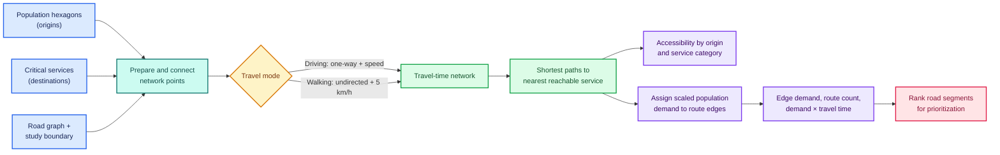
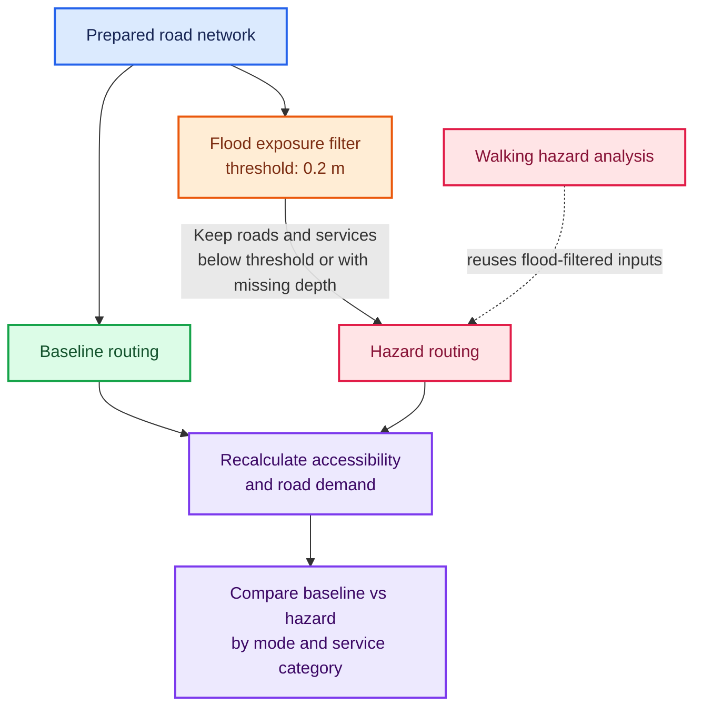

# Accessibility and road-disruption analyses

This folder contains exploratory analyses of how disruption to the road network
can affect access to critical services and how demand is distributed across
roads. The work uses the [Deltares RA2CE repository](https://github.com/Deltares/ra2ce)
as its modelling context.

## Analyses

| Notebook | Scenario and purpose |
| --- | --- |
| `population_accessibility_driving.ipynb` | Baseline accessibility by driving. |
| `population_accessibility_walking.ipynb` | Baseline accessibility by walking. Treats the network as undirected and assigns a uniform walking speed to road segments. |
| `Hazard_population_accessibility_driving.ipynb` | Accessibility by driving under a flood-disruption scenario. Applies the notebook's flood threshold and removes disrupted roads from the routing network. |
| `Hazard_population_accessibility_walking.ipynb` | Accessibility by walking under the same hazard scenario. Uses an undirected network and uniform walking speed; reuses hazard-prepared inputs from the driving analysis. |
| `road_prioritization.ipynb` | Exploratory road cleanup and prioritization, with a focus on roads that are both flood-exposed and in high demand, and on equity considerations. |

The accessibility notebooks connect population-bearing hexagons (origins) and
critical infrastructure (destinations) to a road network, calculate shortest
paths weighted by travel time, and aggregate population demand onto road
segments. They also report network distance and accessibility by service
category.

## Method

The notebooks follow a network-based, origin-to-service workflow:

### Baseline and flood scenarios

1. **Prepare the study area and demand origins.** Load the road graph, study
   boundary, population hex grid, and critical-infrastructure points. Keep
   hexagons with population greater than 0.5 as origins, and process
   infrastructure by its service category.
2. **Prepare a routable graph.** Clip the road network to the study area, repair
   direction and endpoint inconsistencies, and connect origins and services to
   the network. Driving uses directed edges and respects one-way roads; missing
   or invalid road speeds fall back to 30 km/h. Walking treats the graph as
   undirected and assigns every segment a uniform speed of 5 km/h.
3. **Calculate travel costs.** Convert edge length and speed into travel time in
   minutes (`length_km / speed_km_per_hour * 60`). Use shortest paths weighted
   by travel time to find the nearest reachable service for each origin. Also
   record the network distance in kilometres to that service. Origins with no
   connected route have no reachable-service time or distance.
4. **Represent service demand on roads.** Scale origin population relative to
   the largest origin to a maximum of 25,000, rounding up to an integer. Assign
   that same origin demand to its nearest service, then add it to each edge on
   the shortest route. The edge outputs include accumulated demand, the number
   of origin routes using the edge, and demand multiplied by route travel time.
   The category workflow calculates these measures separately for each service
   category.
5. **Compare baseline and flood scenarios.** The hazard notebooks use a flood
   threshold of 0.2 m: roads and critical locations with flood depth at or above
   the threshold are excluded, then shortest paths and accessibility are
   recalculated on the remaining network. Walking under hazard reuses the
   flood-filtered inputs prepared by the driving hazard notebook.
6. **Prioritize road segments.** The road-prioritization notebook cleans road
   records and ranks segments by their demand, route count, and
   demand-times-travel-time indicators. These rankings help identify
   flood-exposed roads carrying high modeled demand; they are indicators for
   further equity analysis, not a standalone equity measure.

## Results

The notebooks produce spatial outputs that can be mapped and compared across
travel modes and scenarios. They report:

- **Accessibility by population hexagon:** travel time and network distance to
  the nearest reachable critical service, plus the identifier of the connected
  service. Origins with no route are recorded as unreachable.
- **Road-level demand:** modeled demand assigned to each shortest-path edge,
  the number of origin routes using that edge, and demand multiplied by travel
  time. Road-segment rankings are also produced for these indicators.
- **Service-category outputs:** accessibility and road-demand metrics are
  calculated by category as well as across all services.
- **Scenario comparisons:** baseline and flood-filtered outputs let analysts
  identify changes in reachable services, travel times, distances, and
  high-demand road segments for driving and walking.

Typical output layers include `b_hexgrid_Critical_Infra_accessibility.gpkg`
and `hazard_hexgrid_Critical_Infra_accessibility.gpkg` for hexagon
accessibility, and `b_Vulnerability_ranked.geojson` and
`hazard_Vulnerability_ranked.geojson` for ranked road segments. The walking
and category-specific notebooks write corresponding layers with `walk_`,
`walk_hazard_`, or `cat_` prefixes. Output locations are set in the notebooks;
these generated layers are not included in this repository, so this
documentation does not claim numerical results.

### Interpretation and limitations

- The model assigns each origin to its **single nearest reachable service**
  based on travel time. It does not distribute trips across multiple
  destinations or model capacity, congestion, or observed traffic.
- Demand is a population-scaled proxy, not a measured trip count. Although the
  shared demand helper has a distance-decay expression in its docstring, its
  current implementation uses origin population only; it does not apply
  distance decay.
- Flood depths that are missing (`NaN`) are retained by the hazard filters, so
  missing exposure data is treated as not exceeding the threshold. Check
  exposure-data coverage before interpreting hazard results.
- Results depend on the configured speeds, coordinate reference systems,
  network quality, population hex grid, service locations, and flood threshold.

## Shared code

- `functions.py` provides reusable network preparation, point-to-network
  connection, shortest-path, demand-aggregation, and category-specific
  accessibility helpers.
- `simplify.py` provides GeoDataFrame geometry-cleanup helpers, including
  removing small polygons and duplicate or contained features.

## Inputs and outputs

The notebooks expect study-area data that is not stored in this folder. Inputs
include a road graph and study-area boundary, a population hex grid, critical
infrastructure locations, and flood exposure data for hazard scenarios. The
notebooks write derived network, demand, and accessibility layers (GeoPackage
and GeoJSON) to the configured outputs directory.

## Running the notebooks

1. Set up a Python environment with the geospatial and network-analysis packages
   imported by the notebooks, including GeoPandas, Shapely, igraph, xarray,
   `snkit`, and `exactextract`.
2. Update the `root_dir` and any input/output paths in each notebook to point
   to your local study-area data. The current notebooks contain
   machine-specific paths, so they will not run unchanged on another machine.
3. Run the baseline notebook for the selected travel mode. For hazard scenarios,
   prepare the flood-related inputs first; run the driving hazard notebook
   before the walking hazard notebook, which reuses its hazard-prepared data.
4. Review the configured coordinate reference systems, travel speeds, and flood
   threshold before interpreting results.

The notebooks are research workflows rather than a packaged command-line
pipeline: their inputs, parameters, and intermediate outputs are configured in
notebook cells and may need adjustment for a different study area.
